<p align="center">
  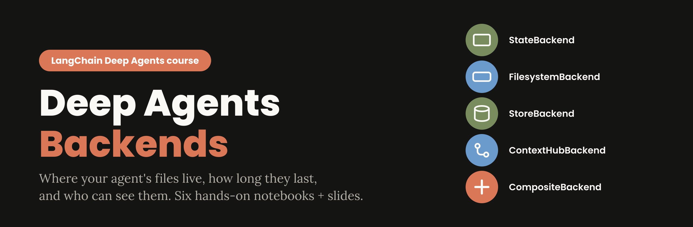
</p>

<p align="center">
  
  
  
  
  
  
</p>

<p align="center">
  <b>
    <a href="#-the-course-at-a-glance">Course map</a> &nbsp;&bull;&nbsp;
    <a href="#-quick-start">Quick start</a> &nbsp;&bull;&nbsp;
    <a href="#-the-big-ideas">Big ideas</a> &nbsp;&bull;&nbsp;
    <a href="#-slide-deck">Slides</a> &nbsp;&bull;&nbsp;
    <a href="#-teaching-this-class-live">Teaching tips</a> &nbsp;&bull;&nbsp;
    <a href="#-project-structure">Structure</a>
  </b>
</p>

---

## 👋 What is this?

A complete, **hands-on class** on one topic of [LangChain Deep Agents](https://docs.langchain.com/oss/python/deepagents/backends):
**backends**, the part that decides where an agent's files really live.

A deep agent gets file tools (`ls`, `read_file`, `write_file`, `edit_file`, `glob`, `grep`, and sometimes `execute`).
The tools never change. The **backend** behind them decides whether a file lands **in memory**, **on your disk**,
in a **database**, in a **versioned repo**, or in **your own storage system**, and who is allowed to see it.

This repo teaches that with:

| | What you get |
|---|---|
| 📓 **6 Jupyter notebooks** | Plain-language explanations, everyday analogies, runnable demos with real AI agents, quizzes |
| 🧭 **27+ diagrams** | Mermaid diagrams rendered right inside the notebooks, in the Anthropic colour palette |
| 🔎 **"Where did the files go?" tables** | After every agent step: the agent's name for a file next to where it *really* is, with a clickable path |
| 🗣️ **Plain-English traces** | "Step 2. The agent OPENED and read the file /pricing.py" instead of raw JSON |
| 🎞️ **A 33-slide deck** | Anthropic brand style (Poppins + Lora, clay orange on ivory), with speaker notes |

> Everything in the notebooks was run end to end against a real model. The outputs you see are real, including
> the surprises we found while preparing the class (they became lessons).

---

## 🗺️ The course at a glance

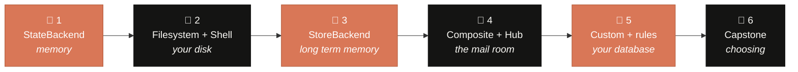

| # | Notebook | You will learn | Star demo |
|:-:|---|---|---|
| 1 | [**What is a backend? StateBackend**](notebooks/01_backends_foundations_statebackend.ipynb) | Files that live in one conversation, subagents sharing files, huge tool outputs parked in a file | A 179,329-character log that never enters the AI's context |
| 2 | [**Real files: Filesystem and LocalShell**](notebooks/02_filesystem_and_localshell.ipynb) | "Every file has two names", locking the agent in one folder, giving it a terminal, human approval | The agent fixes a real bug by itself, then asks permission before deleting |
| 3 | [**Memory across conversations: StoreBackend**](notebooks/03_storebackend_and_namespaces.ipynb) | Stores, drawers (namespaces), the receptionist (namespace factory), keeping users apart | Mallory reads Alice's allergy when drawers are shared, and cannot when they are not |
| 4 | [**One filesystem, many places: Composite and ContextHub**](notebooks/04_composite_routing_and_contexthub.ipynb) | Routing by folder name, longest rule wins, read-only company docs, versioned repos | One assistant using memory, a database and a disk folder at the same time |
| 5 | [**Your own storage and rules**](notebooks/05_custom_backends_permissions_policies.ipynb) | Building a backend on a SQL table, permission rules, a policy guard with an audit log, image offloading | A pasted API key is blocked and logged before it reaches the knowledge base |
| 6 | [**Capstone: choosing the right storage**](notebooks/06_capstone_choosing_backends.ipynb) | Five questions per folder, 12 real products, a multi-company assistant | Two companies ask the same question and get opposite, correct answers |

<details>
<summary><b>🖼️ Peek at some of the diagrams inside the notebooks</b></summary>
<br>

| Two names for every file (Notebook 2) | One drawer per user (Notebook 3) |
|:-:|:-:|
| 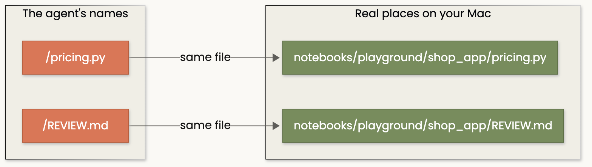 | 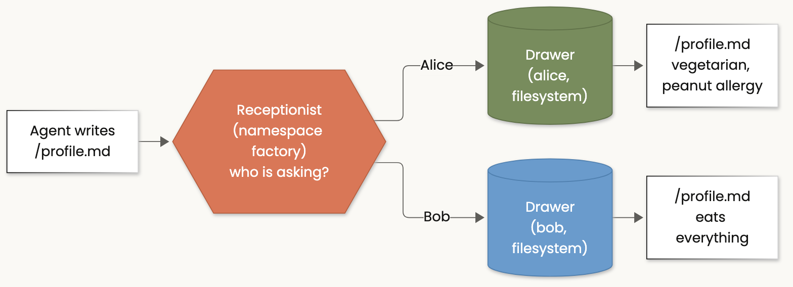 |
| **The mail room (Notebook 4)** | **Checkpoints of one save (Notebook 5)** |
| 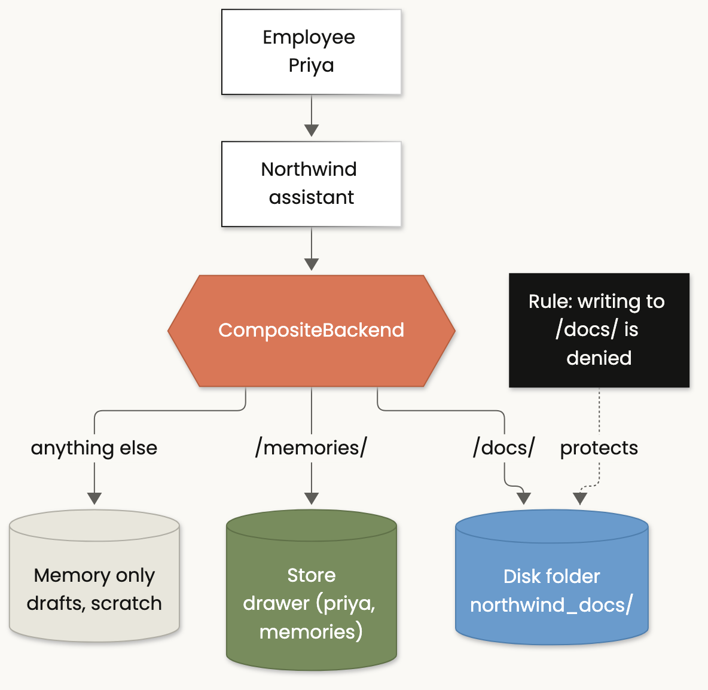 | 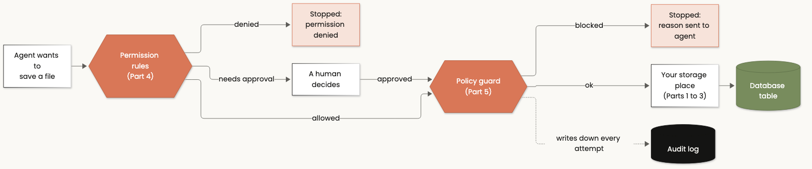 |

</details>

---

## 🚀 Quick start

**1. Clone and install** (Python 3.11 or newer)

```bash
git clone https://github.com/fnusatvik07/deep-agents-backends.git
cd deep-agents-backends
python3 -m venv .venv
source .venv/bin/activate
pip install -r requirements.txt
python -m ipykernel install --user --name deepagents-class --display-name "Python (deepagents class)"
```

**2. Add your OpenAI key**

```bash
cp .env.example .env
# then open .env and paste your key: OPENAI_API_KEY=sk-...
```

**3. Open the notebooks**

```bash
jupyter lab notebooks/
```

Pick the kernel **"Python (deepagents class)"** and run each notebook **from top to bottom**.
In VS Code, just open a notebook and choose the same kernel.

> 💡 The default model is `openai:gpt-5.4-mini` (fast and cheap for live demos). Use another one for the whole
> class by setting `COURSE_MODEL=openai:gpt-5.5` in `.env`.

---

## 💡 The big ideas

### 1. The tools stay the same. The backend decides everything else.

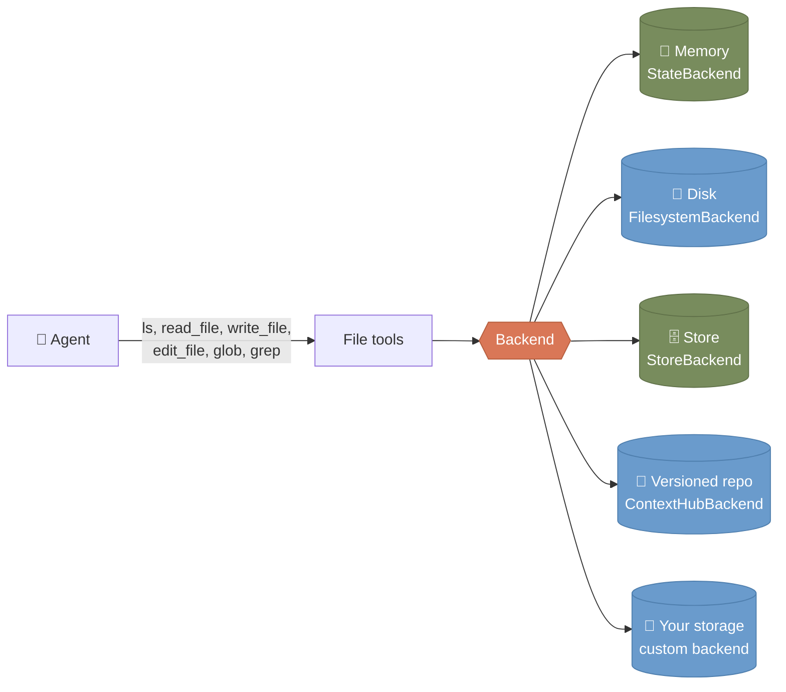

### 2. Every file has two names

When the agent says *"I created `/REVIEW.md`"*, that is the **agent's name**. The **real place** might be a
folder on your disk, a drawer in a database, or nowhere at all (memory only). Every notebook prints both:

```text
WHERE DID THE FILES GO?
------------------------------------------------------------------------------
Agent's name for it : /REVIEW.md
Where it really is  : ON YOUR DISK -> .../notebooks/playground/shop_app/REVIEW.md
Can you open it?    : yes, click the path above
------------------------------------------------------------------------------
Agent's name for it : /large_tool_results/call_O81n...
Where it really is  : IN MEMORY ONLY (inside this conversation, never written to disk)
Copy you can open   : .../notebooks/agent_files/nb02_two_trays/large_tool_results/call_O81n...
```

### 3. Choosing a backend: five questions, asked per folder

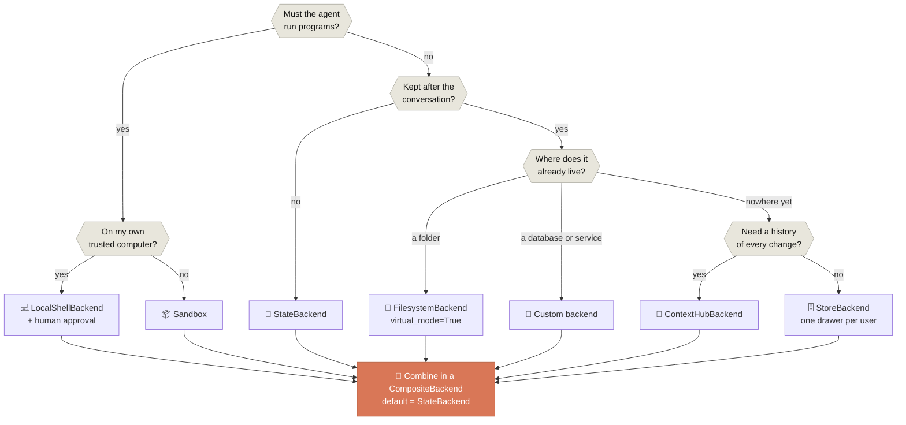

### 4. Rules to remember

| ✅ Do | ❌ Don't |
|---|---|
| `FilesystemBackend(root_dir=..., virtual_mode=True)` | Leave `virtual_mode` off: `..` walks out of the folder |
| Keep the default route on `StateBackend` | Make a durable store the default: scratch files pile up forever |
| Put the **user or company first** in every namespace | Use one fixed namespace in a multi-user app |
| Require approval for **every** destructive tool (`execute` **and** `delete`) | Gate only the shell: the agent will simply use `delete` |
| Enforce content rules in a **policy guard** | Trust the model alone to refuse secrets |
| Use a sandbox for untrusted code | Put disk or shell backends on a public server |

---

## 🎞️ Slide deck

[`Deep_Agents_Backends.pptx`](Deep_Agents_Backends.pptx): 33 slides with speaker notes, built in the
**Anthropic brand style** (Poppins headings, Lora body, `#141413` / `#FAF9F5` / clay `#D97757`).

| | |
|:-:|:-:|
| 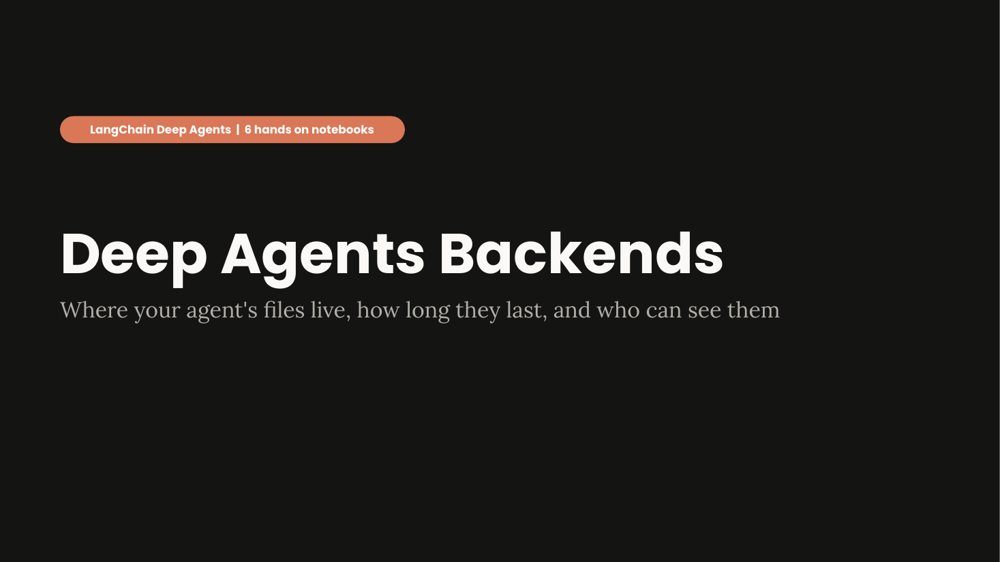 | 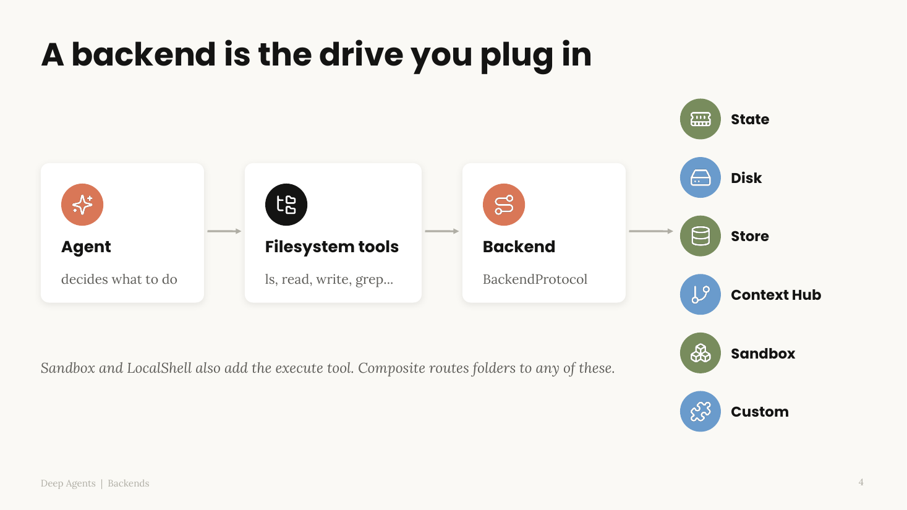 |
| 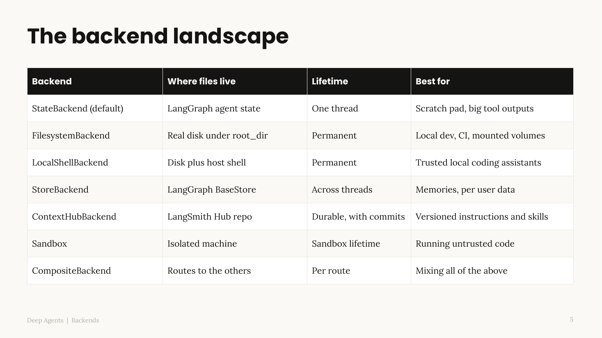 | 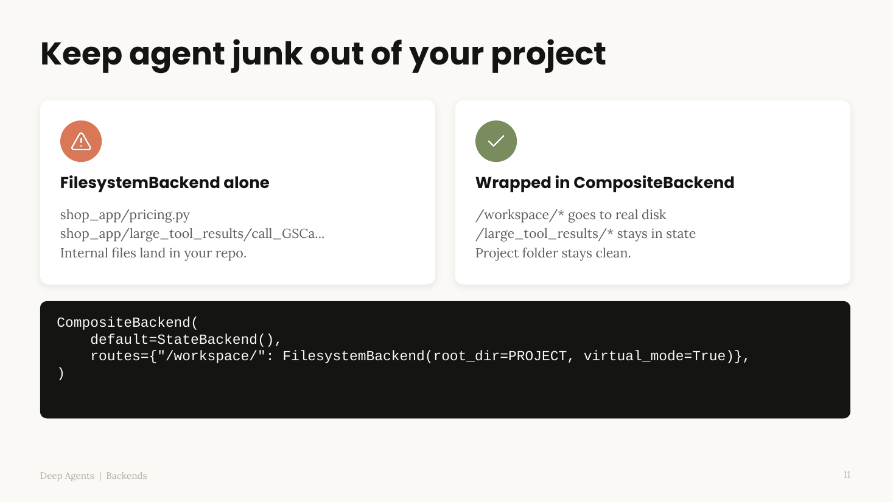 |
| 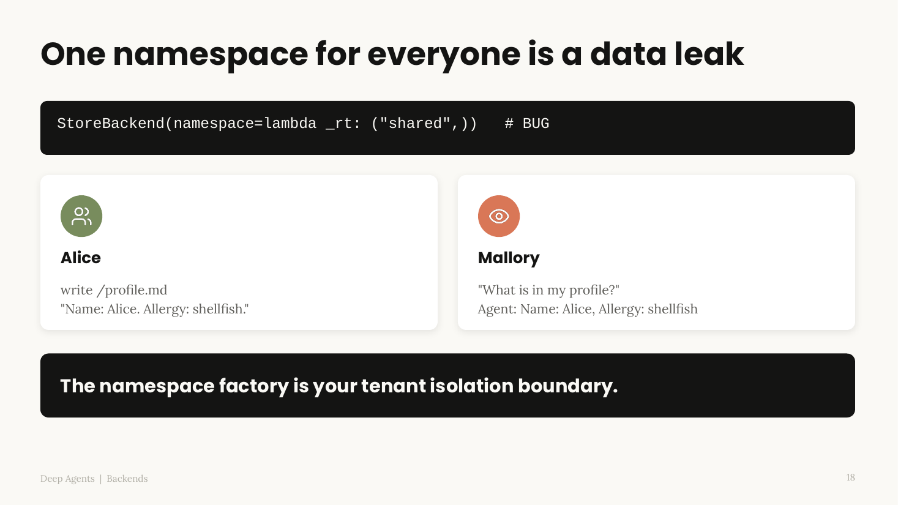 | 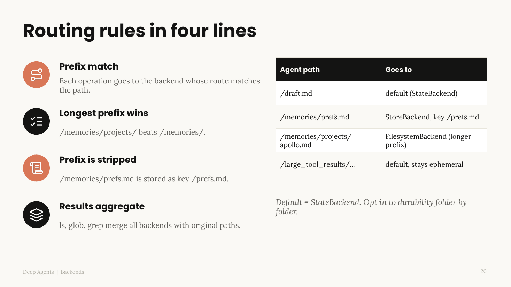 |
| 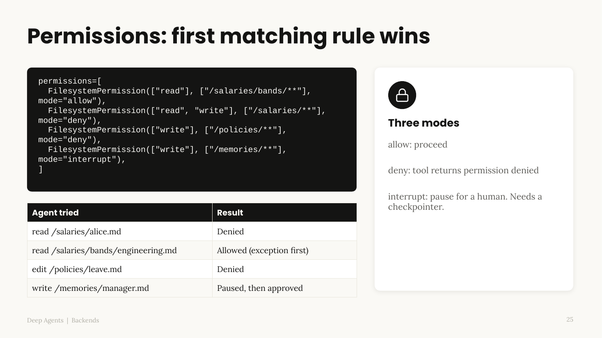 | 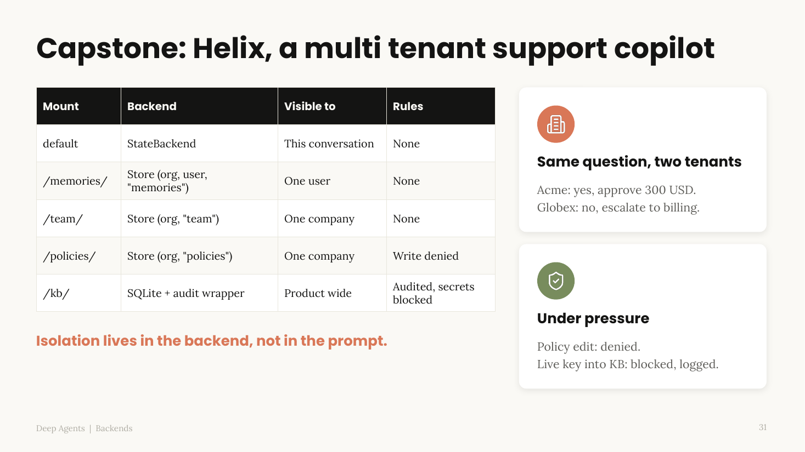 |

> 🔤 Install the free Google fonts **Poppins** and **Lora** on the presenting computer so the slides look exactly as designed.
> To rebuild the deck: `cd slides_build && npm install && PPTX_SKILL_DIR=/path/to/anthropics-skills/skills/pptx NODE_PATH=$PWD/node_modules node build_deck.js`
> (the theme step uses the `apply_theme.js` script from [Anthropic's pptx skill](https://github.com/anthropics/skills)).

---

## 🧑‍🏫 Teaching this class live

* **Notebook 2 builds its own demo project.** Part 1 creates `notebooks/playground/shop_app/` from scratch on
  every run: a buggy `pricing.py` (a 20% discount on 200 gives 180 instead of 160), its tests, a README, a config
  file, and a **fake** `secrets.env` next to it. To reset before a class, just delete `notebooks/playground/`.
* **Keep the VS Code Explorer open** while running notebook 2: students watch `REVIEW.md`, the
  `large_tool_results/` clutter, and the fixed `pricing.py` appear on disk.
* **Every notebook's first cell reloads the helpers**, so a kernel that was already running never uses stale code.
* **AI answers vary between runs.** That is a feature for teaching: the plain-English trace shows exactly what
  the agent did, so the class can check the work instead of trusting the reply.
* **Lessons we hit while preparing** (all kept in the notebooks):
  * the agent used `delete` when only `execute` needed approval
  * an agent replied *"Noted"* without saving anything
  * parallel tool calls broke a SQLite backend until it got a lock
  * a case-sensitive search led an agent to invent an answer

---

## 📁 Project structure

```text
deep-agents-backends/
    notebooks/
        01_backends_foundations_statebackend.ipynb
        02_filesystem_and_localshell.ipynb
        03_storebackend_and_namespaces.ipynb
        04_composite_routing_and_contexthub.ipynb
        05_custom_backends_permissions_policies.ipynb
        06_capstone_choosing_backends.ipynb
        course_utils.py        # plain-English traces, "where did the files go?", folder views
        custom_backends.py     # SQLiteBackend + AuditedPolicyBackend (built in notebook 5)
        diagrams/              # Mermaid sources (.mmd) and rendered images (.png)
        playground/            # created by the notebooks when you run them (not in git)
    Deep_Agents_Backends.pptx  # the slide deck
    slides_build/build_deck.js # deck generator (pptxgenjs)
    tools/mermaid_config.json  # diagram theme (Anthropic palette)
    docs/images/               # README banner and slide previews
    requirements.txt
    .env.example               # copy to .env and add your OpenAI key
```

<details>
<summary><b>🎨 Re-rendering a diagram</b></summary>

```bash
cd tools && npm install @mermaid-js/mermaid-cli
npx mmdc -i ../notebooks/diagrams/<name>.mmd -o ../notebooks/diagrams/<name>.png \
  -c mermaid_config.json -b "#FAF9F5" -s 2
```
</details>

---

## 🔐 Safety notes

* Your real key lives only in `.env`, which is listed in `.gitignore`. Never commit it.
* All "secrets" in the notebooks (`fake_live_key_123`, `sk-ABCDEF1234...`) are **fake**, made up to demonstrate leaks.
* Notebook 2 runs shell commands on your machine, inside `notebooks/playground/` only, with a minimal environment.
  Read each cell before running it.

---

## 📚 Sources and credits

* Official docs this class is based on: [Deep Agents: Backends](https://docs.langchain.com/oss/python/deepagents/backends)
  and the linked pages on [permissions](https://docs.langchain.com/oss/python/deepagents/permissions) and
  [sandboxes](https://docs.langchain.com/oss/python/deepagents/sandboxes).
* Slide styling follows Anthropic's public [`brand-guidelines`](https://github.com/anthropics/skills) skill;
  the deck was built with the `pptx` skill from the same repository.
* Diagrams: [Mermaid](https://mermaid.js.org/).

<p align="center"><sub>Built for teaching. Run it, break it, and check where every file really goes. 🧡</sub></p>
